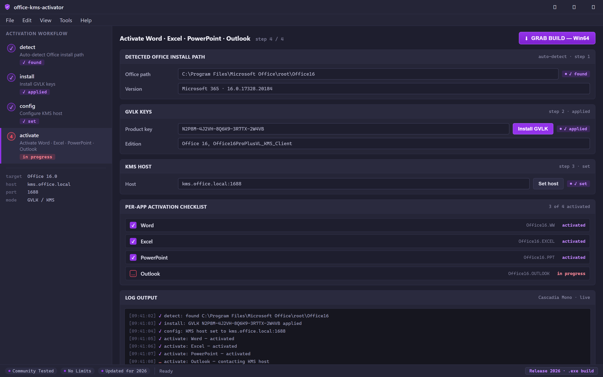
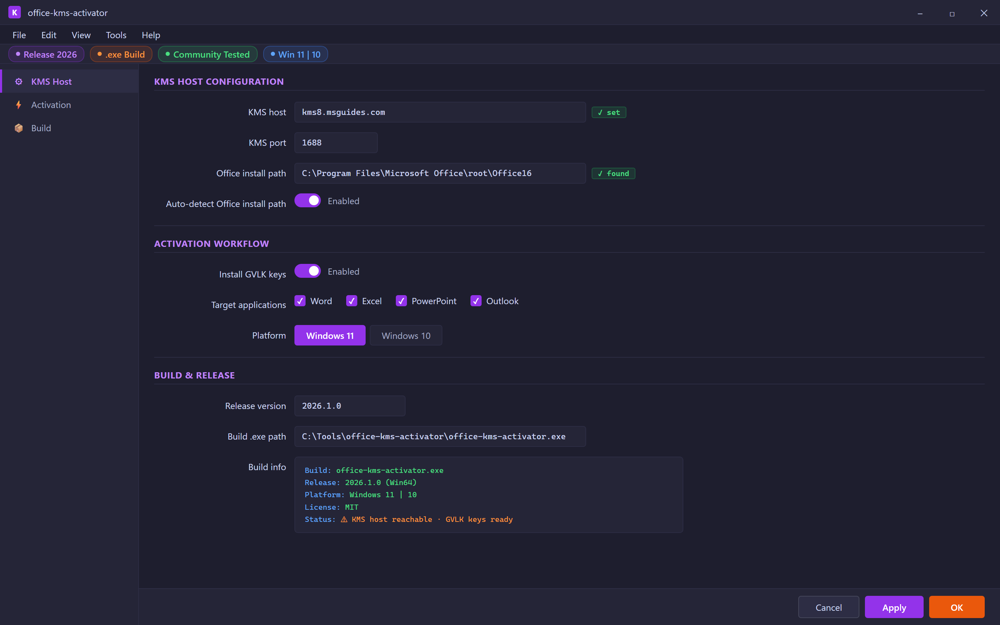
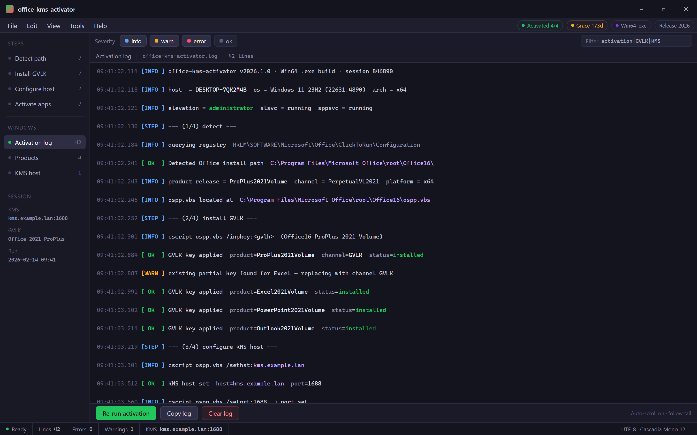

  
  
  

  

  
  
  

---

Microsoft Office KMS activator script — auto-detect Office install path, install GVLK keys, configure KMS host, activate Word/Excel/PowerPoint/Outlook

Four-step KMS activation — detect, install, config, activate.

## Overview

Microsoft Office KMS activator script — auto-detect Office install path, install GVLK keys, configure KMS host, activate Word/Excel/PowerPoint/Outlook

Point at the KMS host, pick targets, apply.

  

Every step, timestamped — detect through activation.

## License

[MIT License](LICENSE)

  

